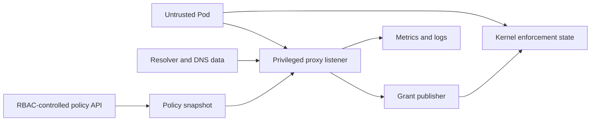

# DNS policy threat model — conditional review draft

## Security summary

The new trust boundary is **untrusted Pod DNS traffic entering a privileged node process which can authorize later egress**. The largest risk is not just a DNS parser crash: it is turning an untrusted answer, stale policy, or another Pod's observation into permission to reach a protected address.

This assessment covers the proposed proxy design and this experimental implementation. It is not a security approval for PR #3 or a production launch. Assumptions were sent to the user for confirmation and remain **pending**: potentially hostile tenants; unprivileged business Pods; RBAC-controlled policy writers; NPA and the node already privileged; no SG/ENI validation in this environment. Tenant capabilities and resolver ownership materially change the priorities below.

## Scope, assets and evidence

Protect Pod-to-destination isolation, policy precedence, availability of node DNS, integrity of pinned BPF state, and privacy of queried names. Out of scope: a compromised node administrator, hostNetwork/Fargate/Windows/Hybrid Nodes, DNS-name ingress/deny, and TLS hostname enforcement. Arbitrary code execution in a business Pod is in scope; arbitrary privileged node access is not.

Runtime entry points are UDP/TCP DNS on intercepted paths, Kubernetes endpoint updates, Pod/CNI lifecycle events, agent restart and the Prometheus endpoint. Upstream DNS answers are external input, even when queries go to the original resolver. Build/test supply chain is separate: the disposable harness has cluster-admin and metadata substitutes and must never be deployed as an EKS release manifest.

Evidence: [transport](../../../pkg/dnsproxy/server_linux.go), [answer handling](../../../pkg/dnsproxy/handler.go), [interception selection](../../../pkg/proxymanager/proxymanager.go), [grant invalidation](../../../pkg/filter/domain_rules_repository.go), [datapath lifetime](../../../pkg/ebpf/c/tc.v4egress.bpf.c#L430), [test privileges](../../../test/dns-policy-poc/stack.yaml). The port's 65,536-entry, 392-byte value map consumes about 30 MB per allocated Pod map in this environment; capacity planning cannot assume it is cheap.

## Prioritized abuse paths

| Threat | Preconditions and attack | Impact / likelihood / priority | Existing protection and remaining work |
|---|---|---|---|
| Resolver mints arbitrary permission | Pod can query attacker-controlled DNS; reply maps an allowed name to a sensitive IP | Isolation bypass / high under unrestricted resolver access / **high** | Original destination is preserved, but is not authenticated as trusted. Define approved resolvers and DNS egress controls. Demonstrate this attack before signing off D4 |
| Cross-Pod or recycled-IP grant | Spoofed source, reused IP/name, or response racing Pod deletion selects the wrong grant owner | Cross-tenant access / medium / **high** | Interface+source membership and Pod recheck help; full Pod UID/generation and atomic lifecycle invalidation required |
| Stale or partial authorization | Policy removal, concurrent answers, map exhaustion or crash leaves old/partially written grants | Unauthorized new traffic / medium / **high** | POC serializes normal publication/removal and returns SERVFAIL on writer error. Multi-key writes and invalidation failure propagation are incomplete. Use versioned commit, failure injection and explicit revocation semantics |
| Wrong precedence or overlapping TTLs | Same destination is covered by domain Accept and earlier IP Deny, or several independent names/ports | Policy bypass or unintended denial / high for complex policy / **high** | POC excludes full CNP conformance. Production needs source-rule provenance, order tests, per-grant deadlines and shared-IP aggregation |
| Node-level DNS denial of service | Pod floods queries, long TCP sessions or large/hostile answers; expensive state writes and conntrack scans exhaust resources | Node/tenant DNS outage / high / **high** | 128 concurrent handlers and deadlines are limited controls. DNAT scans conntrack; global lock and large maps remain risks. Add per-Pod budgets, bounded memory, parser/fuzz tests, load shedding and saturation alarms |
| Privileged network manipulation | Proxy exploit or bad configuration misuses raw sockets, marks, routing or nft rules | Node traffic integrity compromise / medium / **high** | Fixed owned table and source-interface selection reduce accidental scope. Review NET_ADMIN/NET_RAW, reserve mark/routing resources, validate config, package only required binaries, and assess process separation before GA |
| Source identity changes upstream | Node-originated forwarding bypasses Pod SG restrictions or changes source-based DNS answers | SG contract violation / topology-dependent / **high** | Destination preservation alone is insufficient. Test real branch ENIs and both SG modes; adapt or explicitly limit support |
| DNS attribution leaks/misleads | High-cardinality Pod/domain labels expose names or associate a shared-IP denial with the wrong policy | Privacy loss, memory pressure, bad incident response / medium / **medium** | Proposed POC metrics are absent. Use bounded state/grant counters; do not invent packet-to-domain attribution |

Shared IPs and attacker-controlled records under an otherwise allowed domain are also **limits of the product model**. IP/port authorization cannot prove which HTTP host or TLS name a connection uses. Product documentation must explain this rather than imply an L7 guarantee.

## Required mitigations and validation gates

Before functional completeness: validate the resolver authority model, Pod UID lifecycle, response provenance, policy-revision barrier, complete multi-address publication, grant overlap and CNP precedence. Test forged/unrelated answer records, CNAME loops, zero/short TTL, policy deletion during delayed responses, map exhaustion and source identity reuse. The POC has only a subset of these checks; normal-path successes are not substitutes for fault tests.

Before default enablement: threat-model review of actual EKS/SG packet paths; least-privilege assessment; fuzzing and resource limits; authenticated supply chain/SBOM; restart/upgrade/rollback drills; independent AppSec sign-off. Begin these during design and integration, not at the end of implementation. Observability must distinguish DNS path outage, grant-write failure, saturation and stale-state recovery.

Residual risks and the established-flow expiry contract require named product/AppSec owners. This draft must be revisited after assumptions and EKS topology evidence are confirmed. No accepted architecture decision is changed by this threat analysis.
