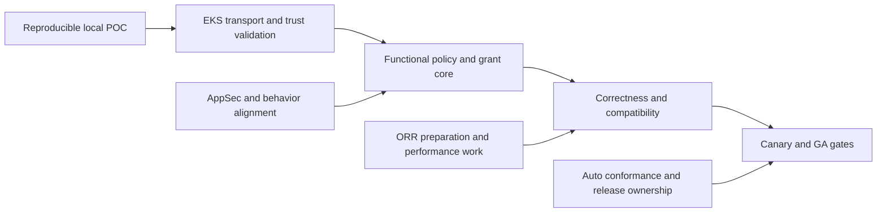

# Delivery plan from transport experiment to GA

**Team-review draft, not a committed schedule.** User-approved constraints are fixed; unresolved behavior and technical choices remain conditional. This plan supersedes the earlier instruction to stop before any milestone draft only to the extent of the user's later explicit request for a POC-to-GA review plan. It does not mark proposed decisions accepted.

## The critical path

Prove a compatible DNS path → validate it on VPC CNI/EKS → establish correct grant lifetime and ordering → close the required support matrix → pass operational and release gates. Transport comparison alone is not the functional MVP.

**Planning assumption:** two full-time engineers spanning NPA/datapath and controller/CNI integration, with available review partners and an EKS test account. A provisional engineering range is **10–19 elapsed weeks after scope alignment and AWS access**, excluding external review/release queues. This includes a provisional allowance for the recommended destination-aware transport; the pure-path core decomposition is approximately 9–16 weeks. This is a decomposition-based planning hypothesis, not historical velocity or an evidence-backed commitment. Transport adaptation, CNP order provenance and SG strict are the largest unknowns. Re-estimate after the first EKS milestone; do not turn the range into a launch promise.

## 0. Make the experiment transferable

**Outcome:** another engineer can reproduce the candidate matrix and see an actual ANP-controlled application connection, not merely successful DNS. Indicative remaining effort: 1–3 engineer-days for internal reproduction/review, excluding cloud access.

Scope: package the pinned controller/port revisions, build and kind scripts, UDP/TCP Service DNS, real NodeLocal tests with confirmed NOTRACK rules, exact/wildcard selection, Pod/port isolation, TTL and policy-removal checks, failure evidence, and an English Draft PR. Components: this NPA branch, unmodified controller snapshot, test harness. Excludes production support, full CNP, IPv6, active-flow revocation and performance claims.

Acceptance: candidate results reproducible with image and kernel provenance; failures remain visible; test-only metadata/CNI adapters are documented; no test cluster-admin manifest presented as EKS deployment guidance. Evidence: JSON results, unit-test log, PR and runbook. Security: initial trust-boundary review and no customer workloads. Operational work starts with a failure-mode inventory and explicit cleanup. Dependency: a Linux Docker environment with required kernel features. External decision: agree the next transport adaptation from measured evidence.

## 1. Qualify the transport on EKS and settle behavior contracts

**Outcome:** the chosen approach observes eligible Pod DNS, returns answers and installs correct grants on actual AL2023/VPC CNI nodes. Indicative range: 1–2 weeks if no transport redesign is needed; otherwise re-estimate.

Scope: build/package `nft`/`ip` or equivalent rule programming, validate capabilities/kernel modules, reserve marks/routing/listener resources, confirm both DNS legs and SG source identity, exercise DNS Service and NodeLocal topologies, test default NP standard/strict startup behavior separately from SG modes. Prove PE/CPE compatibility and CNP order source with a small fixture. Components: NPA, VPC CNI manifests/image, controller experiment only if needed. Excludes GA defaults and full feature completeness.

Acceptance: packet captures and effective map state explain every tested path; DNS remains independently authorized; no capture loop; unsafe configurations fail readiness visibly; test adapter is absent on EKS. Test managed node groups, Karpenter and self-managed placement as scheduling/lifecycle variants, not three separate policy engines. Security: AppSec reviews resolver authority and node-originated forwarding. ORR: assign runtime/oncall owners and draft rollback/diagnosis runbooks. Dependencies: AWS account, supported node images, access to relevant VPC CNI/SG owners. Completion evidence: EKS matrix, selected transport ADR and resolved/rescoped D3/D4/D6 contracts.

## 2. Build the functional policy and grant core

**Outcome:** namespace and cluster domain rules coexist with IP rules under the agreed semantics, with correct normal-path lifecycle. Indicative range: 3–5 weeks.

Scope: existing PE/CPE consumption; Pod UID isolation; case-insensitive exact/prefix wildcard matching; additive namespace grants; optional supported ports/protocols; Admin/namespace/Baseline evaluation; ordered CNP source correlation if needed; userspace grant provenance; shared-IP/port aggregation; individual TTLs; policy update/delete; response publication barrier; bounded capacity errors. Components: controller translation/RBAC if order correlation is needed, NPA compiler/state, eBPF maps/evaluator. Excludes broad OS/SG certification and GA release controls.

Acceptance: executable precedence matrix includes swapped CNP Accept/Deny rules and tier conflicts; two Pods and two names sharing an IP retain independent grants; deletion and expiry revoke according to the approved connection contract; all addresses publish consistently or the answer fails safely. Tests: unit/property tests for matching and compilation, deterministic clock tests, kernel integration tests, delayed-response/update races and publication failure injection. Security: no best-effort truncation, no stale revision grants; targeted AppSec review before merging security-sensitive datapath code. ORR: define metric semantics and draft dashboards during this work. Dependencies: behavior agreements and order-source proof. Evidence: conformance fixtures and reviewed ABI/state design. External decision: Auto semantic differences must be resolved or explicitly documented, not guessed.

## 3. Complete failure recovery and the support matrix

**Outcome:** the feature remains correct through restart, overload, IP reuse and supported deployment variants. Indicative range: 3–5 weeks, partly overlapping milestone 2 once interfaces stabilize.

Scope: atomic generation publication/revocation; pinned-state migration; Pod churn; agent/API/resolver failure; reconciliation retries; graceful and unclean upgrade/rollback; IPv6; AL2023 and Bottlerocket; NodeLocal variants; SG standard and the approved strict-mode outcome; EKS and self-managed distribution; mixed Auto/non-Auto CRD compatibility. Add bounded metrics, dashboards and alarms. Components: NPA, eBPF SDK/datapath as required, CNI packaging/configuration, controller/CRD ownership.

Acceptance: failure injection cannot create new unauthorized grants; readiness reflects a working interception/publication path; resource use stays within a measured dense-node budget; same-family-only behavior is verified; support exclusions are explicit. Tests: packet-loss/timeouts, large/truncated DNS, malformed/CNAME answers, dual resolver/failover, workload DNS caching across NPA restart, ARM64/x86_64, rolling upgrade and rollback, ordinary NetworkPolicy regressions, scale/soak. Security: fuzzing, threat-model update and mitigation closure. ORR: operational drills, log/metric privacy/cardinality validation and oncall training. Dependencies: target images and platform partners. Evidence: compatibility report, fault matrix, benchmark method/results and runbooks. Excludes launching before known security/recovery gaps close.

## 4. Release safely and define GA

**Outcome:** a supported versioned feature can be enabled, observed and rolled back without undocumented policy changes. Indicative range: 2–4 weeks of engineering/canary work; release calendars and approval queues are additional.

Scope: publish minimum VPC CNI/controller/CRD requirements; validate R11 default/upgrade semantics and add-on configuration; supported non-Auto ANP CRD installation; mixed-node capability checks; canary stages and rollback triggers; operational dashboards/runbooks; customer limitations and examples. Auto switching to OSS remains a separately approved release, not a prerequisite to EC2 support.

Acceptance: clean install, upgrade, downgrade/disable and partial rollout tests pass; default-on behavior is approved by release/product owners; AppSec findings resolved or formally accepted; ORR owners sign readiness; canary thresholds are established from measured baselines, not arbitrary percentages. Dependencies: all required support/correctness gates and release owner approval. Completion evidence: signed release checklist, published support matrix/version floor, canary report and oncall handoff. Excludes silently declaring a POC-only limitation to be GA support.

## Conditional branches and work that can proceed now

| Unresolved choice | Change to sequence / effort | Work independent of the choice |
|---|---|---|
| Pure DNAT retained | Must resolve NodeLocal NOTRACK and original-destination recovery before EKS qualification; full conntrack scan cannot ship | Policy compiler, grant provenance, threat review |
| Pure TPROXY retained | Must resolve IPVS Service interception; transparent/raw reply validation and privilege review remain | Same shared core |
| Destination-aware DNAT + TPROXY | Add reliable Service/NodeLocal address classification, update races and configuration safety; allow roughly 1–3 extra engineering weeks provisionally (already included in the headline 10–19-week range), subject to EKS proof | Same proxy handler and grant state |
| CNP order requires original-CNP informer | Add revision correlation, RBAC and stale-source tests; provisional 1–2 engineering weeks within or beyond core range | ANP and lifetime work can proceed |
| Immediate established-flow revocation required | Add generation/deadline checks and conntrack migration/performance work; provisional 2–4 engineering weeks | Transport and resolver qualification |
| SG strict needs source-preserving forwarding | No credible estimate before real branch-ENI experiment; may require a new forwarding topology | Standard-mode work and approved limitation documentation |
| Auto conformance differs | Preserve verified evidence and return to behavior review; no automatic scope expansion or schema change | EC2 transport and nonconflicting tests |

These increments are not all additive: shared work and staffing overlap matter. A hybrid transport is still proxy-based and keeps TC/eBPF DNS interception excluded. It introduces a new configuration dependency, so it cannot be sold as a cost-free fix.

## Requirements coverage and explicit exclusions

- **R1–R8:** functional policy core and CRD validation/conformance; R4 ordering is a team-review contract, not a proven Auto fact.
- **R9:** grant lifetime/revocation core plus recovery; established-flow behavior must be explicitly resolved.
- **R10:** shared CRDs and Auto black-box conformance, with separate Auto migration approval.
- **R11–R13:** release ownership, installation/upgrade semantics and published version floor at launch; no version guessed here.
- **R14–R18:** EKS/self-managed and node/OS/IP-family/NodeLocal/SG qualification. Strict SG limitation requires approval.
- **R19–R22:** revise metrics semantics during core work, implement bounded useful state/grant signals in completeness, validate operational value before launch. Packet counters and domain attribution are separate feasibility questions.

The original non-goals remain excluded: domain deny/ingress/Pass, suffix/mid-string wildcard, cross-family enforcement, Hybrid Nodes, hostNetwork business Pods, Fargate, Windows, automatic DNS allowance, customer TTL knobs and full flow/domain observability. Host networking for **the NPA container** does not bring hostNetwork business Pods into scope.
