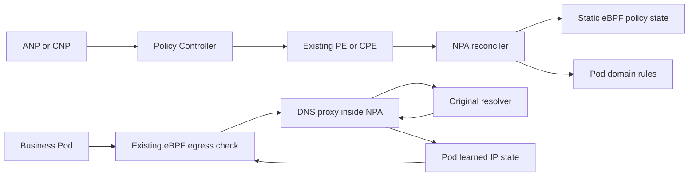

# What this investigation can prove

The EC2 design can reuse the **proxy pattern**, but the available port is not evidence that the internal Auto implementation behaves identically. This review uses three explicitly separate baselines.

| Source | Exact revision | What it establishes |
|---|---|---|
| AWS NPA upstream | `6ef2c1806e976b5aa5470ec7d0cd6f764cd083b4` | Merged upstream baseline, distinct from DNS work in progress |
| AWS policy controller | `65a296e580b827b323b53be461ff46b768ba34d4` | Real ApplicationNetworkPolicy selection and PE generation used in the experiment |
| [Port PR #3](https://github.com/Issacwww/aws-network-policy-agent/pull/3) | `7a19bce604217ad0b244af65451158d73ea0e606` | Experimental DNS state, controller hooks and eBPF DNS lookups; not merged-upstream or internal-Auto proof |
| This POC | Branch `codex/dns-proxy-poc`; see PR commit and evidence | Replacement interception/forwarding path and executable local evidence |

The working branch is based on PR #3, not AWS main. This intentionally preserves the real agent/datapath for experimentation. A production contribution must separate and review the inherited changes; a passing transport POC does not approve the entire port.

## Policy and packet paths are different

The controller owns label/namespace selection and endpoint distribution. The agent owns node-local Pod identity, domain rules, interception and learned grants. The datapath owns packet verdicts. VPC CNI owns Pod interfaces and the agent's DaemonSet deployment/lifecycle. Keeping PE/CPE unchanged does not imply keeping every internal map unchanged.

The normal VPC CNI deployment uses host networking: the NPA container shares the node network namespace. A proxy started by the NPA process therefore listens in that namespace; it is not a Kubernetes Service hop. The kind harness reproduces that placement, but substitutes EC2 metadata, ipamd configuration RPC and VPC-style veth names. It does **not** substitute policy selection, DNS authorization or eBPF enforcement. See [test deployment](../../../test/dns-policy-poc/stack.yaml) and [adapter](../../../test/dns-policy-poc/adapter/main.go).

## Evidence that constrains the design

- `PolicyEndpointsReconciler.configureeBPFProbes` separates domain and IP rules, installs interception, then programs static state. Domain firewall rules already encode namespace priority as `1500*10+1`. See [PE controller](../../../controllers/policyendpoints_controller.go#L353). Cluster domain rules have different priority handling: do not apply another encoding globally or claim CNP equivalence.
- `WriteIPsForPod` writes an IP-keyed per-Pod map with expiry and port rules. [Writer](../../../pkg/ebpf/bpf_client.go#L722), [datapath checkIPCache](../../../pkg/ebpf/c/tc.v4egress.bpf.c#L167). One IP entry cannot faithfully represent independently expiring grants from several names without aggregation/provenance in userspace.
- `handle_egress` checks existing connection state before fresh policy evaluation. [Datapath](../../../pkg/ebpf/c/tc.v4egress.bpf.c#L430). Expiring a DNS entry does not establish that an already admitted connection is terminated.
- The port compares cluster policy priority and action; it does not establish original YAML rule order. The current target of first matching CNP rule remains **pending team approval**, and order provenance with unchanged CPE is an implementation dependency.
- The POC invalidates learned entries on policy reconciliation and serializes it with publication. [Repository](../../../pkg/filter/domain_rules_repository.go). Clearing all grants is conservative and disrupts cached applications; it is not the proposed production provenance model.
- `GetPodIdentifier` uses full Pod name while the experiment is enabled, avoiding workload-shared DNS grants. [Identity](../../../pkg/utils/utils.go). UID/generation protection and migration from old pinned-map identities remain production work.

## How to interpret local evidence

The experiments use Kubernetes 1.35.0 on kind and LinuxKit 6.10.14, ARM64. The native macOS process does not run Linux netfilter or eBPF. All packet tests execute in Docker's Linux VM.

New kind includes its own NetworkPolicy enforcement. The fixture uses ApplicationNetworkPolicy for both DNS transport and domain permission, avoiding a second independent engine which understands ordinary NetworkPolicy but not AWS ANP. The initial dual-enforcement failure was diagnosed with netfilter tracing; it was not an NPA allow failure. Production interoperability with ordinary NP remains a separate regression gate.

Exact images, individual results and runtime configuration are recorded in [POC report](poc-report.md). EKS ENIs, Security Groups for Pods, AL2023, Bottlerocket, IPv6 and internal Auto were not exercised. No claim of zero-change EKS compatibility follows from these results.

## Local checkout provenance

| Checkout | Branch / state at preparation | Handling |
|---|---|---|
| `/Users/ssuchao/Code/aws-network-policy-agent` | `main`, `6ef2c1806e976b5aa5470ec7d0cd6f764cd083b4`; untracked prior `docs/` | Preserved. Remote refs fetched; no destructive reset or overwrite |
| `/Users/ssuchao/Code/amazon-network-policy-controller-k8s` | `feature/crd-installer`, `1ff19f84100245f31488075e0c7207e6d227c8ba`; local deletion of `main` | Preserved; not fast-forwarded or used as the merged baseline |
| `/tmp/dns-policy-investigation/controller-65a296e` | Clean detached upstream snapshot at controller SHA above | Built the real controller and used its CRDs |
| `/Users/ssuchao/.codex/worktrees/dns-proxy-poc/aws-network-policy-agent` | `codex/dns-proxy-poc`, based on port SHA above | Isolated implementation and documentation; see Draft PR head for resulting commit |

The Draft PR is stacked on the port branch so reviewers can distinguish this work from the inherited port. Checking out this branch includes the dependency; the port remains unmerged work in progress.
