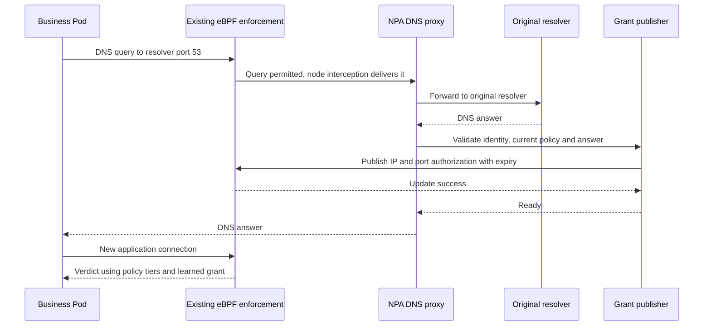

# DNS policy on EC2: preserve the resolver, authorize the resulting connection

**Review proposal, not a GA implementation.** The recommended direction is a DNS proxy embedded in NPA, with Pod-scoped learned grants compiled into eBPF enforcement state. Keep PE/CPE unchanged and leave existing Auto agents running. Use the local POC to select an interception mechanism, then validate it on EKS before making a support claim.

Read sections 1–3 first. Sections 4–6 explain the correctness and release decisions the team must settle. The [decision record](decisions.md) distinguishes accepted constraints from proposals; the [POC report](poc-report.md) separates measurements from inference.

## 1. What changes for a Pod

A domain rule does not open DNS access. Existing policy must independently permit the DNS query. When an eligible Pod asks its resolver for an allowed name, the proxy observes the answer, publishes the corresponding IP/port permission, and only then returns a successful answer. Subsequent application packets still go through NPA's eBPF checks.

If publication fails, the proposed contract is SERVFAIL for a matching answer, never an apparently usable answer before enforcement is ready. Unmatched names can still resolve; they simply create no domain grant. Negative answers create no grant. This is an authorization feature, not a general DNS query blocking product.

The POC follows this response barrier for normal writes. Multi-address writes are not atomic, invalidation failures are not fully handled, and existing connections can outlive grants. These are explicit completeness gaps, not guarantees inferred from the diagram.

## 2. Where the proxy runs and how traffic reaches it

The proxy is a listener in the NPA process inside the hostNetwork VPC CNI Pod. It shares the node's network namespace. There is no extra DNS Deployment, per-Pod sidecar or Kubernetes Service in this proposal. Container placement does not force DNAT or TPROXY; both deliver traffic to this listener.

`nftables` is the rule configuration system. **DNAT versus TPROXY is the actual mechanism choice**; both candidates in this POC use nftables. kube-proxy may independently use iptables, IPVS or nftables.

| Conceptual step | DNAT candidate | TPROXY candidate |
|---|---|---|
| Select eligible traffic | Match Pod ingress interface plus source IP and UDP/TCP destination port 53 | Same selection, before Service translation |
| Deliver to NPA | Rewrite destination to a dedicated local address and proxy port | Attach transparent socket, mark packet, policy-route to local delivery |
| Recover the intended resolver | TCP SO_ORIGINAL_DST; UDP conntrack tuple lookup in this POC | TCP socket local address; UDP original-destination ancillary data |
| Avoid interference | NAT chain before kube-proxy destination NAT | Scoped NOTRACK on client leg prevents later Service NAT; forwarding leg remains normally tracked |
| Forward upstream | New node-originated connection to original resolver | Same |
| Return answer as the resolver | Reply from translated local address; reverse NAT restores original source | Transparent TCP; raw IPv4 UDP reply with correct source and checksum, avoiding a NodeLocal port-53 bind conflict |

**Recommendation:** take a destination-aware combination into the next EKS validation: DNAT for explicitly identified Service resolver addresses, TPROXY for NodeLocal/non-Service resolvers. Pure DNAT misses authorization when NodeLocal bypasses conntrack; pure TPROXY leaves IPVS Service traffic to IPVS before socket delivery. The added `hybrid` experiment shares the same listener and grant handler and tests this compatibility split. This is **PROPOSED**, not a production approval.

The POC configures the Service address list explicitly through `DNS_POLICY_DNAT_RESOLVERS`. It does not infer a production topology. A supported implementation needs authoritative address classification, atomic updates, stale-list detection and clear handling of NodeLocal co-binding a Service IP. Until those are proven, a passing local-address NodeLocal test is not universal NodeLocal support. Prefer one combined policy over selecting the entire mechanism solely by kube-proxy mode: the same IPVS node can receive both Service and NodeLocal queries.

| Choice | Advantages | Costs and theoretical consequences |
|---|---|---|
| DNAT | Familiar NAT lifecycle; TCP original destination and reverse replies are straightforward | UDP original-destination recovery needs state; the POC scans conntrack and is unsuitable for load. NodeLocal NOTRACK can bypass NAT altogether, so DNS may succeed without installing permission |
| TPROXY | Preserves destination on the client leg and can operate with untracked traffic | Needs kernel support, transparent sockets, mark/routing ownership, scoped NOTRACK and safe UDP replies. Raw replies add CAP_NET_RAW exposure and more tests |
| Destination-aware combination | Uses each mechanism where the measured path works; same proxy/authorization core | More rule state and configuration ownership; classification mistakes can silently bypass learning. This is the recommended next validation target, not a free abstraction |
| Fixed-upstream DNAT | Smaller implementation, avoids original-destination recovery | Not selected: violates accepted original-resolver behavior, potentially bypassing NodeLocal/custom DNS |

No TPROXY daemon/binary must be installed by customers. The POC image contains `nft` and `ip`; the node kernel must support the required netfilter/socket/routing operations. Production can program netlink directly to reduce subprocess dependencies, but that does not remove kernel prerequisites. AL2023/Bottlerocket validation and privilege reduction remain required. The POC's fixed mark/table/address require conflict detection and ownership coordination before launch.

## 3. The state that makes DNS permissions correct

Interception is only one part of the design. A destination IP can be returned by several names with different policies, ports and expiry times. A single last-answer-wins map update cannot preserve that information.

**Recommended ownership:** NPA maintains a grant ledger keyed by Pod UID, policy revision, source rule and DNS observation. Each observation stores the queried name, validated CNAME path, addresses and individual expiry times. A compiler produces the effective IP/port/rule state consumed by eBPF. Kubernetes policies remain authoritative; learned DNS state can only instantiate their permissions.

| Component | Responsibility and interface | Failure invariant |
|---|---|---|
| Endpoint reconciler | Existing PE/CPE to immutable local policy revision and selected Pods | Do not publish against an older policy revision after deletion |
| Interception manager | Own Pod-interface membership, rules, listener and routing | Rules never capture unrelated node traffic; advertise readiness only when the complete path works |
| DNS transaction handler | Pod identity, original resolver, response validation, bounded work | Reject malformed/mismatched answers; never turn unrelated answer/additional records into grants |
| Grant ledger/compiler | Merge overlapping observations, compile ports/precedence and deadlines | Removing one grant cannot erase another still-valid grant or extend its TTL |
| Publisher/datapath | Commit effective state; evaluate new application traffic | No successful matching answer before commit; no partial grant generation visible as complete |

The POC reuses the port's IP cache and clears it conservatively on policy changes. It uses a global publication lock and full Pod-name map identity. These are useful experimental simplifications, not the proposed production ledger, Pod-UID isolation or scalable synchronization design.

**Map design trade-off.** Extending the existing IP cache is smaller and preserves a separate static-policy path, but independent deadlines and ordered rules require richer values or additional indirection. A separate versioned grant generation allows atomic publication/revocation and rollback at higher memory/ABI complexity. Recommend prototype the existing-cache extension first, with a generation check and explicit capacity rejection; adopt double buffering only if multi-address publication cannot meet the barrier safely. Never silently truncate eligible rules.

## 4. Preserve precedence without pretending the port already does

The target is Admin → namespace policies → Baseline. CNP policy priority is numerical; inside one CNP the current working design uses written rule order and first match. Namespace NetworkPolicy/ApplicationNetworkPolicy retain additive allows.

For example, “Accept allowed domain on TCP 443; then Deny all IPs” should admit a valid learned address on 443. Reversing the rules should deny it. IP and domain candidates therefore need the same ordering key. Sorting by action or doing an unconditional DNS allow before IP deny is incorrect for this chosen contract.

The existing endpoint conversion does not establish original rule position. With PE/CPE schemas fixed, first prove whether generation/chunking can preserve sufficient order in existing fields. If it cannot, correlate original CNP rules via an additional read-only informer and revision binding. That alternative adds RBAC, synchronization and stale-source handling; it needs a bounded prototype before committing implementation effort. It does not change the overall proxy architecture. Do not fabricate order from resource/watch arrival time.

The local POC proves ANP transport and authorization only. Full CNP ordering, same-priority conflicts and Auto conformance are deliberately not claimed.

## 5. Failure and lifetime behavior require explicit contracts

| Situation | Proposed production behavior | POC / decision boundary |
|---|---|---|
| One answer has several addresses | Validate all; commit a complete effective generation before replying | POC writes sequentially. Failure can leave partial grants; must be fixed before functional completeness |
| Map full or publication error | SERVFAIL; rollback/invalidate partial generation, alarm on sustained failures | SERVFAIL path unit-tested; atomic recovery not implemented |
| Policy deleted during upstream query | Re-evaluate current revision before publish; revoke only affected grants | Lock and conservative cache clearing cover normal POC deletion; fault handling is incomplete |
| TTL expires | Datapath deadline prevents new admission even if userspace GC is delayed | POC uses monotonic deadlines; expired storage is not proactively reclaimed |
| Active connection reaches TTL/deletion | Team must choose continuing established flows versus revalidation | POC tests fresh connections only; existing conntrack fast path can keep flows alive |
| Refresh returns different IPs | Keep each still-valid observation until its own expiry unless product requires replacement semantics | Ledger needed; no customer-configurable TTL or arbitrary grace interval |
| TTL zero / CNAME | No invented TTL extension; bound A/AAAA grant by relevant chain TTL | POC skips zero-TTL grants and follows at most 16 CNAME links; zero-TTL usability needs Auto/product review |
| Proxy outage or resolver timeout | No new grants; matching query fails; still-valid existing grants follow the chosen contract | POC leaves interception fail-closed for DNS and requires explicit restart cleanup |
| Agent restart | Reconcile Pod UID/policy revisions, invalidate unverifiable grants, restore path before readiness | Pinned map recovery and stale rule ownership are launch blockers; application DNS caches complicate recovery |
| Pod deletion/IP reuse | Remove membership and grants by UID/generation; reject in-flight old identity | Full UID lifecycle protection is not implemented |

Persisting learned grants across restart improves availability for applications caching DNS, but requires trustworthy timestamps, policy revisions and Pod identity. Rebuilding from scratch is simpler and safer but can temporarily deny valid cached destinations. Recommend conservative rebuild for the first supported release **only after** the availability contract is approved; test long-lived application caches explicitly.

IPv6 should use the same model with IPv6 sockets, interception and AAAA keys, applying only the cluster IP family. IPv4-mapped or cross-family answers must not create cross-family permissions. IPv6 and Bottlerocket are separate required support gates, not implied by IPv4 success.

## 6. Security, observability and rollout change the plan

The proxy forwards with node identity in this POC. Preserving destination does not preserve Pod SG identity, source-based DNS views or per-Pod upstream ACLs. EKS standard/strict SG tests can require an adaptation; strict mode may instead become an explicitly documented limitation. Do not promise an unchanged binary will work on every EKS topology.

An authorized domain answered by an attacker-controlled resolver can authorize a sensitive IP. The original-resolver decision is a routing contract, not a trust policy. Align the approved resolver boundary and DNS transport policies with AppSec before launch. Shared IPs also mean this is IP/port authorization, not proof of TLS hostname or per-request domain use. See the [threat model](aws-network-policy-agent-threat-model.md).

For R19/R22, an application packet contains an IP, not the name that caused it to be allowed or denied. Multiple names can share that IP. Recommend bounded grant-publication counters and active-state gauges on the existing NPA Prometheus endpoint. Do not label arbitrary packet drops with guessed domains. A packet-decision counter needs datapath events/counters and policy correlation; exact domain attribution is still not generally possible. R20/R21 should specify whether they count configured names, live per-Pod observations or effective IP grants. Pod/domain labels on an unbounded counter create cardinality and DNS privacy risks. Metric names/semantics require product agreement; the POC does not implement the proposed metrics.

The POC is explicitly opt-in through `DNS_POLICY_INTERCEPTION`. GA enablement must define CNI/controller/CRD ownership, a minimum supported version, feature discovery on mixed nodes, safe rollback and a canary. R11–R13 cannot be satisfied by inventing a release number or assuming `enableNetworkPolicy` upgrades every component. EKS/self-managed distribution and Auto migration have different release owners.

**Decision dependencies:** original resolver preservation constrains interception; NodeLocal constrains conntrack and reply sockets; reply sockets constrain privileges; ordered CNP constrains grant representation and order provenance; active-flow revocation constrains conntrack/ABI migration; default-on depends on every compatibility and recovery gate. The [milestones](milestones.md) reflect these dependencies rather than treating them as independent task lists.
